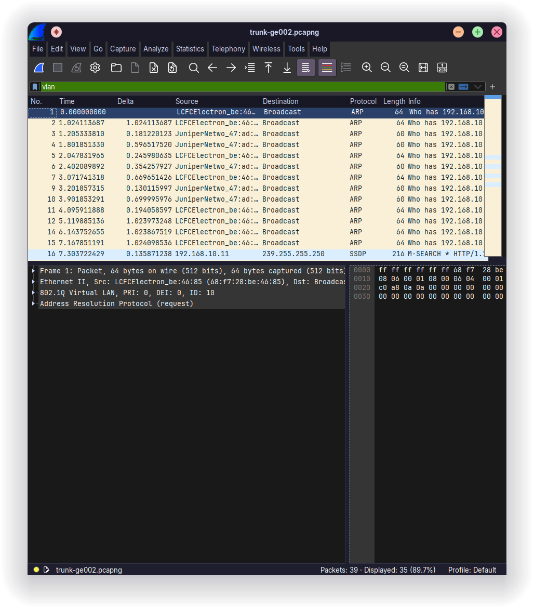
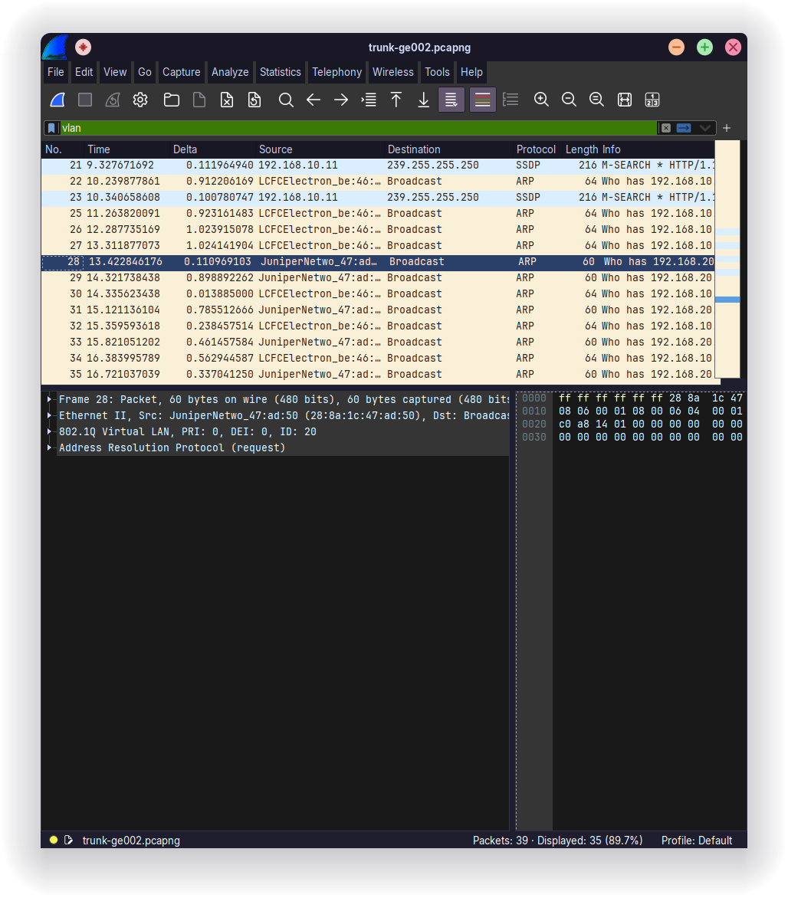
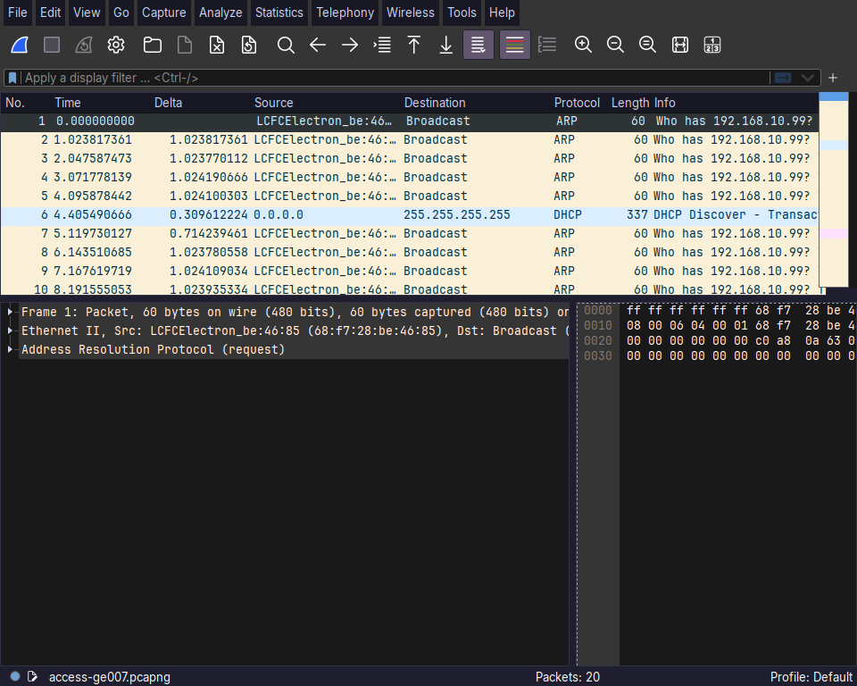

# Testplan – Assignment 38 (SRX Tagged Interfaces and 802.1q trunk traffic)

Udført 2026-11-10 på R1 / SRX-C1 og R2 / SRX-C2 med én PC på hver router og en Linux-laptop til Wireshark. Enheder og adresser som i [README](README.md) og [HLD](HLD.pdf).

| Enhed | Maskine | Port | VLAN / zone | MAC | Adresse |
|---|---|---|---|---|---|
| R1 / SRX-C1 | SRX240H-POE, AH4113AK0093 | vlan.10 / vlan.20 | SALES / OPERATIONS | 28:8a:1c:47:ad:50 | 192.168.10.1/24 og 192.168.20.1/24 |
| R2 / SRX-C2 | SRX240H, AG4809AA0482 | – | – | – | ingen |
| PC1 | Skolens Lenovo | SRX-C1 ge-0/0/6 | SALES (10) | 68:f7:28:be:46:85 | 192.168.10.10/24, GW 192.168.10.1 |
| PC2 | Sebastians laptop | SRX-C2 ge-0/0/3 | OPERATIONS (20) | 34:5a:60:29:94:d8 | 192.168.20.5/24, GW 192.168.20.1 |
| PC2 i test 8–9 | Sebastians laptop | SRX-C2 ge-0/0/6 | SALES (10) | 34:5a:60:29:94:d8 | 192.168.10.11/24, GW 192.168.10.1 |
| PC3 | Thomas' ThinkPad, Linux, Wireshark 4.7.4 | SRX-C1 ge-0/0/2, senere ge-0/0/7 | trunk / SALES | 90:2e:16:68:ae:cd | ingen, lytter kun |

Forberedelse: Wi-Fi er slået fra på PC1 og PC2, så trafikken går gennem SRX'erne.

## Tests

| # | Test | Fra | Kommando | Forventet | Resultat | Status |
|---|---|---|---|---|---|---|
| 1 | Trunk og access-porte på SRX-C1 | SRX-C1 | `show ethernet-switching interfaces` | ge-0/0/5 og ge-0/0/2 i begge VLANs som `tagged`, resten `untagged` | Som forventet; ge-0/0/5 og 0/6 up | Bestået |
| 2 | Trunk og access-porte på SRX-C2 | SRX-C2 | `show ethernet-switching interfaces` | ge-0/0/5 i begge VLANs som `tagged`, resten `untagged` | Som forventet; ge-0/0/3 og 0/5 up | Bestået |
| 3 | SRX-C1 lærer PC2 over trunken | SRX-C1 | `show ethernet-switching table` | PC2 i OPERATIONS på ge-0/0/5.0 | 34:5a:60:29:94:d8 i OPERATIONS på ge-0/0/5.0 | Bestået |
| 4 | SRX-C2 lærer gatewayen over trunken | SRX-C2 | `show ethernet-switching table` | 28:8a:1c:47:ad:50 i OPERATIONS på ge-0/0/5.0 | Som forventet | Bestået |
| 5 | PC2 når sin gateway gennem trunken | PC2 | `ping 192.168.20.1` | Svar | Svar | Bestået |
| 6 | Routing OPERATIONS → SALES | PC2 | `ping 192.168.10.10` | Svar fra PC1 | Svar | Bestået |
| 7 | SALES → OPERATIONS afvist | PC1 | `ping 192.168.20.5` | Ingen svar | Ingen svar | Bestået |
| 8 | Samme VLAN over trunken | PC2 flyttet til SRX-C2 ge-0/0/6, 192.168.10.11/24 | `ping 192.168.10.10` | Svar fra PC1 | Svar | Bestået |
| 9 | Gateway i SALES gennem trunken | PC2 som i test 8 | `ping 192.168.10.1` | Svar | Svar | Bestået |
| 10 | Trafik på trunk-port er tagged | PC3 på SRX-C1 ge-0/0/2 | Wireshark, filter `vlan` | Rammer med 802.1Q-header, ID 10 og ID 20 | 35 af 39 rammer tagged, ID 10 og ID 20 | Bestået |
| 11 | Trafik på access-port er untagged | PC3 på SRX-C1 ge-0/0/7 | Wireshark, filter `vlan` | Ingen rammer med 802.1Q-header | 0 af 20 rammer tagged | Bestået |

## Wireshark-måling (test 10 og 11)

Målt med PC3, som kører Linux. Windows fjerner 802.1Q-tagget, så det kan ikke ses der.

### Test 10: tagged på trunken

PC3 sad i ge-0/0/2 på SRX-C1. Porten er trunk med de samme to VLANs som ge-0/0/5, så den sender det samme som går til SRX-C2. Imens pingede PC1 adressen 192.168.10.99, og SRX-C1 pingede 192.168.10.99 og 192.168.20.99. Adresserne findes ikke, så der sendes ARP-broadcast ud på alle porte i VLAN'et, også trunk-portene.

Optagelse: `trunk-ge002.pcapng`.

| VLAN ID | Afsender | Ramme |
|---|---|---|
| 10 | PC1 (68:f7:28:be:46:85) | ARP Who has 192.168.10.99? Tell 192.168.10.10 |
| 10 | SRX-C1 (28:8a:1c:47:ad:50) | ARP Who has 192.168.10.99? Tell 192.168.10.1 |
| 10 | PC2 (34:5a:60:29:94:d8) | SSDP, kommet over trunken fra SRX-C2 |
| 20 | SRX-C1 (28:8a:1c:47:ad:50) | ARP Who has 192.168.20.99? Tell 192.168.20.1 |

De 4 rammer uden tag er dem PC3 selv sender (DHCP, mDNS, ICMPv6).





Ramme 1 i teksten:

```
Ethernet II, Src: 68:f7:28:be:46:85, Dst: Broadcast (ff:ff:ff:ff:ff:ff)
    Type: 802.1Q Virtual LAN (0x8100)
802.1Q Virtual LAN, PRI: 0, DEI: 0, ID: 10
    Type: ARP (0x0806)
Address Resolution Protocol (request)
```

### Test 11: untagged på access-port

PC3 blev flyttet til ge-0/0/7 på SRX-C1, som er en access-port i SALES. PC1 pingede stadig 192.168.10.99.

Optagelse: `access-ge007.pcapng`. Den samme ARP-ramme fra PC1 ses nu uden 802.1Q-header. Typen er ARP (0x0806) direkte efter Ethernet II. Der er også en ARP fra PC2 (192.168.10.11), som er kommet over trunken fra SRX-C2, og den er også uden tag her.



Tagget sættes altså på når rammen sendes ud på en trunk-port, og fjernes igen før den sendes ud på en access-port.

## Output fra SRX'erne

### SRX-C1 `show ethernet-switching interfaces`

```
Interface    State  VLAN members        Tag   Tagging  Blocking
ge-0/0/2.0   down   OPERATIONS          20    tagged   unblocked
                    SALES               10    tagged   unblocked
ge-0/0/3.0   down   OPERATIONS          20    untagged unblocked
ge-0/0/4.0   down   OPERATIONS          20    untagged unblocked
ge-0/0/5.0   up     OPERATIONS          20    tagged   unblocked
                    SALES               10    tagged   unblocked
ge-0/0/6.0   up     SALES               10    untagged unblocked
ge-0/0/7.0   down   SALES               10    untagged unblocked
```

### SRX-C2 `show ethernet-switching interfaces`

```
Interface    State  VLAN members        Tag   Tagging  Blocking
ge-0/0/3.0   up     OPERATIONS          20    untagged unblocked
ge-0/0/4.0   down   OPERATIONS          20    untagged unblocked
ge-0/0/5.0   up     OPERATIONS          20    tagged   unblocked
                    SALES               10    tagged   unblocked
ge-0/0/6.0   down   SALES               10    untagged unblocked
ge-0/0/7.0   down   SALES               10    untagged unblocked
```

### `show ethernet-switching table` under test 3 og 4

SRX-C1:

```
  VLAN              MAC address       Type         Age Interfaces
  OPERATIONS        *                 Flood          - All-members
  OPERATIONS        28:8a:1c:47:ad:50 Static         - Router
  OPERATIONS        34:5a:60:29:94:d8 Learn          0 ge-0/0/5.0
  SALES             *                 Flood          - All-members
  SALES             28:8a:1c:47:ad:50 Static         - Router
  SALES             68:f7:28:be:46:85 Learn          0 ge-0/0/6.0
```

SRX-C2:

```
  VLAN              MAC address       Type         Age Interfaces
  OPERATIONS        *                 Flood          - All-members
  OPERATIONS        28:8a:1c:47:ad:50 Learn          0 ge-0/0/5.0
  OPERATIONS        34:5a:60:29:94:d8 Learn          0 ge-0/0/3.0
  SALES             *                 Flood          - All-members
```

PC2 sidder på SRX-C2, men SRX-C1 har lært den på trunk-porten ge-0/0/5. På SRX-C2 står gatewayens MAC som `Learn` på ge-0/0/5, fordi gatewayen ligger på SRX-C1.

### `show ethernet-switching table` under test 8 og 9

SRX-C2, efter PC2 er flyttet til ge-0/0/6:

```
  VLAN              MAC address       Type         Age Interfaces
  OPERATIONS        *                 Flood          - All-members
  OPERATIONS        28:8a:1c:47:ad:50 Learn          0 ge-0/0/5.0
  SALES             *                 Flood          - All-members
  SALES             28:8a:1c:47:ad:50 Learn          0 ge-0/0/5.0
  SALES             34:5a:60:29:94:d8 Learn          0 ge-0/0/6.0
  SALES             68:f7:28:be:46:85 Learn          0 ge-0/0/5.0
```

PC1 og PC2 er nu i samme VLAN på hver sin SRX. SRX-C2 har lært PC1 på trunk-porten.

## Konklusion

De to VLANs går over ét kabel mellem SRX-C1 og SRX-C2. På trunken har rammerne en 802.1Q-header med VLAN ID 10 eller 20, og på access-portene har de ingen. PC2 på SRX-C2 bruger gatewayen på SRX-C1, og routing og policies mellem zonerne virker som i Assignment 37. Ikke testet: HTTP fra OPERATIONS til SALES og hvad der sker når trunk-kablet tages ud.
